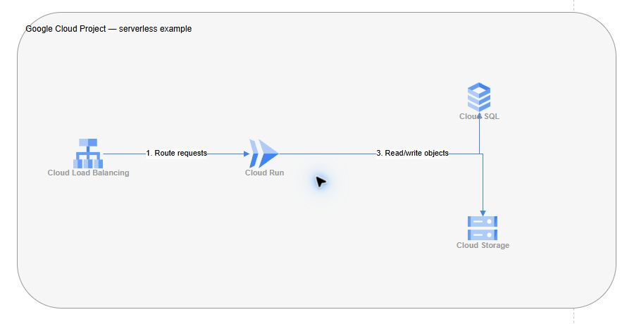

# GCP Architecture Diagram Skill

Generate editable Draw.io architecture diagrams using a catalog of 163 validated Google Cloud SVG icons. Works with agents that can read skill instructions and execute Python, including Cline with local open-weight models, Claude Code, and Codex.

## Sample output

Cloud Load Balancing → Cloud Run → Cloud SQL / Cloud Storage.

[Editable Draw.io file](serverless.drawio) · [PNG preview](serverless.png)



The PNG is a cropped preview of the diagram rendered in Draw.io.

Download and extract [the complete skill package](gcp-architecture-diagram-skill.zip) before following the installation and generation steps below.

## Requirements

Python 3.10 or newer. No third-party Python dependencies. A coding assistant is optional: the generator also runs directly from a JSON specification.

## Install

Copy the entire `gcp-architecture-diagram` directory into your project's assistant skill directory:

| Assistant | Destination |
| --- | --- |
| Cline | `.cline/skills/gcp-architecture-diagram/` |
| Claude Code | `.claude/skills/gcp-architecture-diagram/` |
| Codex | `.agents/skills/gcp-architecture-diagram/` |

Reload the assistant if necessary. Ask: “Use the gcp-architecture-diagram skill to draw Cloud Run connected to Cloud SQL and Cloud Storage.” Cline can use a locally hosted tool-capable open-weight model via Ollama; the skill does not require a specific model provider.

## Run without an assistant

From this repository root:

```sh
python gcp-architecture-diagram/scripts/generate_diagram.py examples/serverless.json examples/output.drawio
```

Open the result in https://app.diagrams.net/ and inspect labels, boundaries, and connector routing. The sample is a logical request/data flow, not a deployment configuration.

## Architecture JSON

Use `containers`, `nodes`, and `edges`. Nodes have unique `id`, exact catalog `service`, optional `label`, `parent`, `x`, and `y`. Coordinates are relative to the parent. Containers add `width` and `height`. Edges specify `source`, `target`, and optional `label`. See `examples/serverless.json`.

## Refresh icons

```sh
python gcp-architecture-diagram/scripts/extract_icons.py
```

This command requires internet access. Generation uses the saved catalog offline. The extractor resolves shared style prefixes, checks extraction coverage, decodes Base64 and parses SVG XML. Malformed upstream icons are reported and excluded; duplicate names receive category suffixes. Source URL and SHA-256 are recorded in `references/source.json`. Icon labels follow the upstream drawing library and may include legacy product names.

## Attribution and third-party assets

Inspired by the [DevelopersIO article](https://dev.classmethod.jp/en/articles/build-gcp-architecture-diagram-skill-for-claude-code/). This is an independent implementation, not the author's original skill package.

Icon definitions originate from [JGraph Draw.io Sidebar-GCP2.js](https://github.com/jgraph/drawio/blob/dev/src/main/webapp/js/diagramly/sidebar/Sidebar-GCP2.js). Upstream copyright notices identify JGraph Holdings Ltd and draw.io AG. Google Cloud names and icons belong to their respective owners. This repository does not grant additional rights to third-party branding or assets; consult the [upstream license](https://github.com/jgraph/drawio/blob/dev/LICENSE) and applicable Google brand terms before redistribution or commercial use.

No company-specific architecture, credentials, or Enterprise Intelligence design notes are included.

